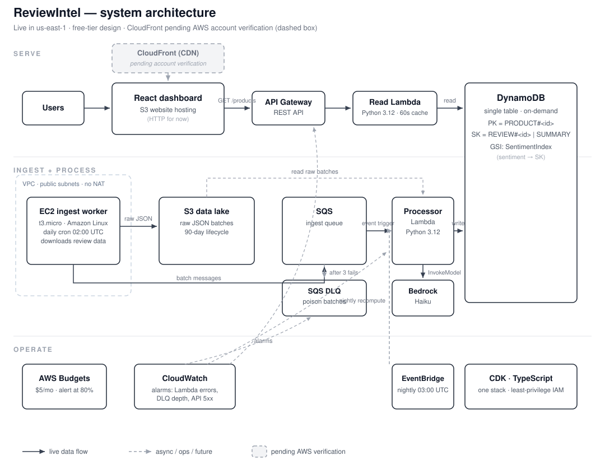

# ReviewIntel

AI-powered product review intelligence. Ingests product reviews, classifies
sentiment and extracts aspect-level insights (quality, shipping, value) with a
large language model, then serves live summaries through a fast read API and a
React dashboard.

## Live demo

- **Dashboard:** http://reviewintelstack-sitebucket397a1860-9yhfmmtei1rr.s3-website-us-east-1.amazonaws.com
- **API:** https://34r6afhfx3.execute-api.us-east-1.amazonaws.com/prod/products

> Note: the dashboard is served over HTTP for now. A CloudFront distribution
> (HTTPS + CDN) is queued behind AWS's new-account verification and will
> replace this URL once approved.

## What it does

- **Product sentiment overview:** every product shows positive / neutral /
  negative review counts and an overall sentiment verdict.
- **Aspect-level summaries:** the model distills what reviewers say about
  quality, shipping, and value into short readable summaries.
- **Faceted browsing:** a DynamoDB global secondary index supports
  browse-by-sentiment queries.
- **Always fresh:** an ingest worker pulls new reviews on a schedule, and a
  nightly job recomputes product summaries automatically.

## How it works

1. An EC2 worker downloads review data on a cron schedule and writes raw JSON
   to S3, then enqueues each batch on SQS.
2. A Lambda function consumes the queue, calls Amazon Bedrock (Claude Haiku)
   for sentiment classification and aspect summarization, and writes results
   to a single DynamoDB table.
3. API Gateway + a read Lambda serve product summaries with an in-memory
   cache for hot products.
4. A React dashboard renders the summaries, sentiment breakdowns, and this
   architecture.

Poison-pill batches go to a dead-letter queue after 3 retries; CloudWatch
alarms watch Lambda errors, DLQ depth, and API 5xx rates.

## Architecture



Data model (single-table DynamoDB):

- `PK=PRODUCT#<id>`, `SK=REVIEW#<id>` — one item per processed review
- `PK=PRODUCT#<id>`, `SK=SUMMARY` — aggregated product summary
- GSI `SentimentIndex` — query products by sentiment

## Tech stack

AWS CDK (TypeScript) · Lambda (Python) · API Gateway · DynamoDB · SQS ·
S3 · EC2 · EventBridge · CloudWatch · Amazon Bedrock · React + TypeScript (Vite)

## Design decisions

- **Single-table DynamoDB** keeps product, review, and summary data in one
  table with one GSI, so reads stay cheap and access patterns stay explicit.
- **Event-driven ingest** (S3 + SQS + Lambda) decouples download, processing,
  and serving, so each stage scales and retries independently.
- **No NAT gateway, no ElastiCache.** The worker runs in a public subnet and
  the API Lambda caches hot products in memory. This keeps the demo near
  free-tier limits without sacrificing the architecture story.
- **Infrastructure as code from day one:** the entire stack is one CDK app,
  one deploy command, least-privilege IAM throughout.

## Performance

Load test against the live API (200 requests, 20 concurrent workers):

| Metric | Cold start | Warm |
|---|---|---|
| Success rate | 95% | 100% |
| p50 latency | 1302 ms | 1350 ms |
| p95 latency | 2892 ms | 2006 ms |
| p99 latency | 3200 ms | 2064 ms |

Latency is dominated by Lambda cold starts under burst concurrency (~1s per
fresh Python environment), not the database. Next steps in order of leverage:
provisioned concurrency on the read Lambda, then a managed cache layer.
Full results in `loadtest/results.md`; the k6 smoke script is in
`loadtest/smoke.js`.

## Run it yourself

Prerequisites: an AWS account, AWS CLI configured, Node.js 20+, Python 3.12+,
AWS CDK, and Bedrock model access for Claude Haiku in your region.

```bash
make install     # install CDK, frontend, and Python dependencies
make synth       # sanity-check the CloudFormation template
make deploy      # build frontend + deploy stack + sync site to S3
```

The site and API URLs print after deploy (also in stack outputs `SiteUrl`
and `ApiUrl`). Set a small billing budget in the console after your first
deploy.

To stop the EC2 worker burning free-tier hours when you are not demoing:

```bash
make destroy
```

## Cost

Designed to sit inside AWS Free Tier: one t3.micro worker, two Lambdas, one
on-demand DynamoDB table, one SQS queue + DLQ, two S3 buckets, API Gateway,
EventBridge, CloudWatch alarms, and a $5 monthly budget with an 80% alert.
Bedrock is pay-per-token; a demo's worth of summaries costs a few cents.

## Project layout

- `cdk/` — TypeScript CDK app: VPC, S3, SQS, DynamoDB, Lambdas, API Gateway,
  CloudFront, EventBridge, CloudWatch alarms, IAM
- `lambdas/processor/` — SQS consumer: Bedrock summarization to DynamoDB
- `lambdas/api/` — API Gateway handler: product list and summaries
- `worker/` — EC2 ingest worker (user data + Python cron job)
- `frontend/` — Vite + React + TypeScript dashboard
- `loadtest/` — k6 smoke script and measured results
- `DESIGN_DOC.md` — narrative design document
